# AppTrail

**See what changed in a Windows application folder.** Capture a working baseline, compare it after an update, and export a readable report with the evidence.

[Download for Windows x64](https://github.com/SeanShaffer88/AppTrail/releases/latest) · [Report a bug](https://github.com/SeanShaffer88/AppTrail/issues) · [MIT license](LICENSE)

## See it in action

Inspect saved source/config changes with colored added and removed lines, encoding details, and optional line-ending markers.

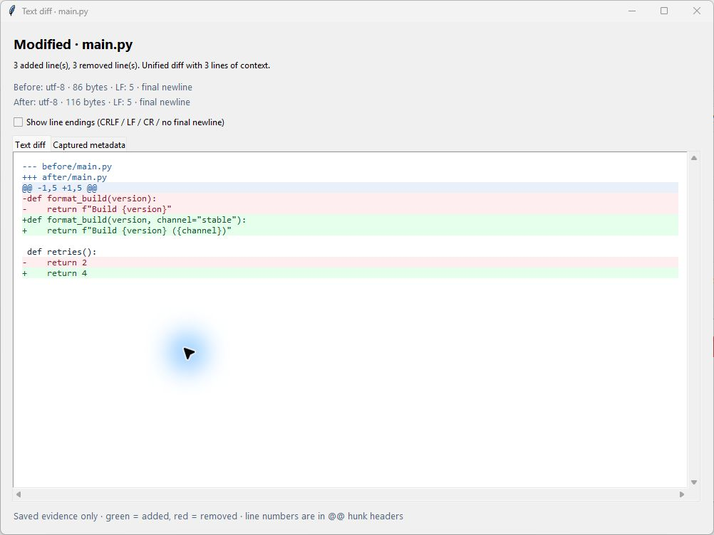

Browse named snapshots, inspect notes, and compare builds against a known-good baseline without selecting JSON files each time.

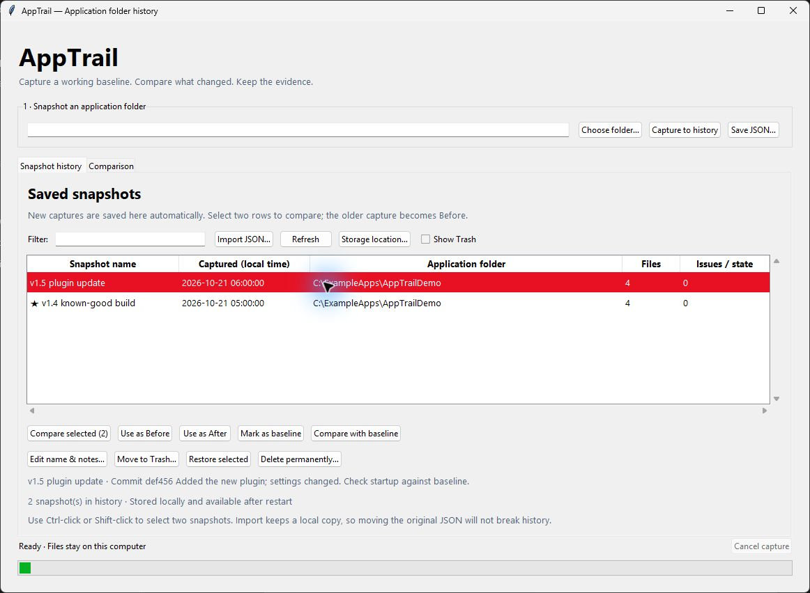

Label captures with a release name, commit ID, or test result while keeping the original evidence unchanged.

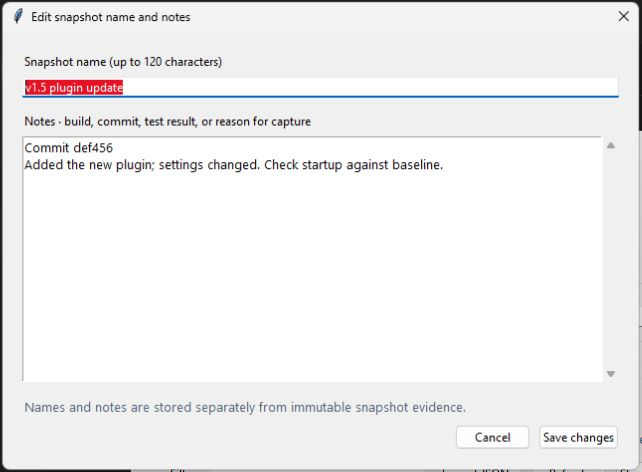

Compare two snapshots to see added, removed, and modified files, with a summary of the evidence for each change.

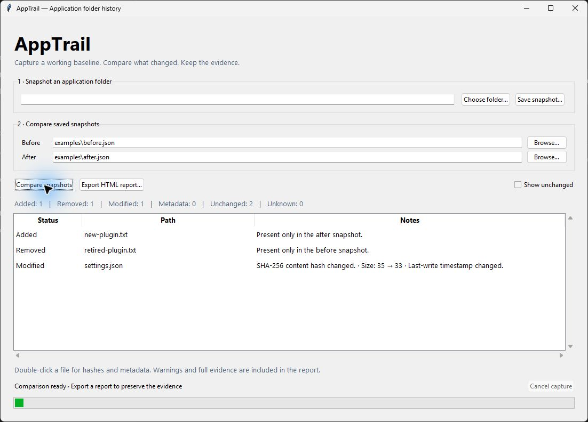

Double-click a file to inspect its before-and-after hashes, sizes, timestamps, and available binary metadata. This example shows the evidence for a changed settings file.

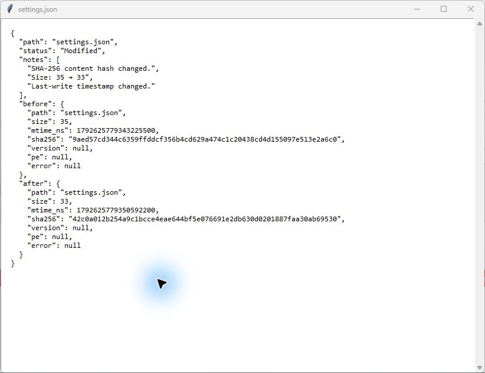

The text diff screenshot shows AppTrail 0.4.0; history/editor show 0.3.0, and the older comparison/evidence views show 0.1.0. All are unedited Windows captures using demo snapshots.

## Download and run

1. Open the [latest release](https://github.com/SeanShaffer88/AppTrail/releases/latest).
2. Download **AppTrail-0.15.0-Windows-x64.zip**, extract it, and double-click **AppTrail.exe**. A direct EXE download is also available.
3. No Python installation, command window, administrator access, or account is required. Keep the license notices with copies you redistribute.

The current executable is an unsigned Windows x64 build, tested on Windows 11 x64. Other Windows versions and native ARM64 execution have not been validated. The bundled runtime extracts into the temporary directory at launch and normally cleans up on exit.

## Capture, compare, report

1. Choose an application folder and click **Capture to history**. No save dialog is needed.
2. After making changes, capture the folder again. Both snapshots appear in **Snapshot history**.
3. Select two rows using Ctrl-click or Shift-click, then click **Compare selected (2)**. The older capture becomes **Before** and the newer becomes **After**. Use **Use as Before** / **Use as After** to set the order manually, then compare on the Comparison tab.
4. Double-click a file to inspect its evidence, or click **Export HTML report** to save a standalone report.

### See source and configuration changes

Leave **Capture source/config text for diffs** enabled when taking two new snapshots. On the Comparison tab, select a changed file and click **View text diff…**, or double-click its row. The Text diff tab shows a color-coded unified diff with hunk line numbers; Captured metadata retains the file evidence. Use **Show line endings** to distinguish CRLF, LF, CR, and a missing final newline. Encoding and BOM differences are summarized above the diff.

Diffs use saved contents, never the current files on disk. Added and removed text files are supported too. HTML reports include escaped saved-text diffs, subject to a 2 MiB included-diff budget; omitted output is explicitly identified and remains available in the desktop view.

New v2 snapshots save eligible source/config text by default, limited to **256 KiB and 3,000 lines per file**, with an **8 MiB total raw-text budget per snapshot**. Supported text is strict UTF-8 or BOM-marked UTF-16/UTF-32. Large files, unsupported encodings, binary data, and non-source/config extensions retain hashes and metadata when readable, but their text is skipped with a reason.

Common credential filenames (`.env*`, `secrets.*`, `credentials.*`, `.npmrc`, `.pypirc`, `.netrc`) and files inside `.git` are excluded from text capture. This is not a secret detector: other configuration files may contain secrets. Snapshots and reports can now contain private source/config contents. Review them before sharing, or turn text capture off. The CLI equivalent is **`--no-text`**.

Legacy v1 snapshots remain readable, but their missing text cannot be reconstructed. Capture two new snapshots to obtain a complete text diff. New v2 JSON requires AppTrail 0.4.0 or later; older apps reject it. Existing history names, notes, and baselines remain available.

Try the new [text-before](examples/text-before.json) and [text-after](examples/text-after.json) demo snapshots, or download the [text diff HTML report](examples/Text-diff-report.html).

You can compare the same application in different folder locations or on different computers. File matching uses case-insensitive relative paths, following normal Windows conventions. AppTrail runs locally; it has no telemetry or cloud upload feature.

Try the included [before](examples/before.json) and [after](examples/after.json) example snapshots, or download the [example HTML report](examples/AppTrail-example-report.html). Example root paths are illustrative.

### Snapshot history

History persists across restarts under `%LOCALAPPDATA%\AppTrail\history` on Windows, independently of the EXE's location. The library stores its own JSON copies and a SQLite catalog. It shows application folder, capture time (local time), file count, and capture issues, with a filter for application, folder, or date.

Use **Import JSON…** once to add existing snapshots, including the demo pair. Identical imports are deduplicated. Moving or deleting the original imported JSON does not break history. Missing library copies are flagged; reimporting the original restores them. AppTrail rejects library JSON modified outside the app rather than silently trusting changed evidence.

**Save JSON…** exports a capture to a location you choose and also adds it to history. Manual JSON selection remains on the **Comparison** tab. Existing v1 snapshot JSON files remain compatible. The source CLI continues to save only to the path you specify; import those snapshots into the desktop history when desired.

History contains local paths and metadata. Back up the entire history directory while AppTrail is closed if you want to retain the library elsewhere. No history is uploaded or synchronized.

### Organize builds and compare against a baseline

- **Edit name & notes…** (or double-click a history row): give a capture a name such as “v1.4 release candidate” and record the commit, test results, or reason for capturing it. Names and notes are searchable and appear in exported comparison reports.
- **Mark as baseline**: designate a known-good snapshot for that application folder. Select another capture and click **Compare with baseline**. The baseline is always Before, regardless of capture date. Choosing a new baseline replaces the previous one for that folder.
- **Move to Trash…**: hide old snapshots from active history while retaining their files and annotations. Turn on **Show Trash** to restore them.
- **Delete permanently…**: select entries in Trash to remove their library files and notes after confirmation. This cannot be undone; original imported JSON files and external reports are untouched. AppTrail recovers interrupted deletion operations when next started.

Names, notes, baseline markers, and Trash state are stored in the SQLite catalog, separately from immutable snapshot evidence. Renaming or annotating a capture never changes its SHA-256 identity. Existing v0.2 catalogs upgrade automatically. Duplicate imports preserve custom details and restore a matching trashed capture; restoring does not reinstate a previous baseline marker.

The [named comparison report example](examples/Named-comparison-report.html) shows how build names, notes, and baseline context travel with exported evidence.

Snapshot JSON exports contain captured evidence, not these catalog annotations. Back up the whole history directory to preserve organization; share a comparison report when you want names and notes included. Notes may contain private development details, so review reports before sharing them.

## What it captures

| Evidence | Details |
| --- | --- |
| File identity | Relative path, size, last-write time, and streaming SHA-256 hash |
| PE binary metadata | Machine architecture, imported DLL names, and delay-imported DLL names |
| Windows file version | Fixed file-version resource when present |
| Capture issues | Read errors, skipped reparse points, malformed metadata, and detected changes during capture |
| Saved text (optional) | Bounded eligible source/config contents for diffs, verified against their recorded byte hash |

Comparison results distinguish **Added**, **Removed**, **Modified** (different content hash), **Metadata** (same hash, changed metadata), **Unchanged**, and **Unknown** (unreliable content comparison).

HTML reports include before/after hashes, metadata, available saved-text diffs, capture warnings, and UTC timestamps. They use no external assets or scripts and can be printed to PDF from a browser.

## Run from source

Requires **Python 3.11 or later with Tkinter**. There are no third-party runtime packages. The packaged GUI release uses Python 3.15.

```powershell
git clone https://github.com/SeanShaffer88/AppTrail.git
cd AppTrail
python -m pip install -r requirements.txt
python -m apptrail
```

On Windows you can also double-click `Launch-AppTrail.pyw`, if `.pyw` files are associated with Python, or use `Launch-AppTrail.cmd`.

### Command line

The CLI is provided by the source distribution; the packaged EXE opens the desktop interface.

```powershell
python -m apptrail snapshot "C:\Path\To\Application" -o "C:\Snapshots\before.json"
python -m apptrail snapshot "C:\Path\To\Application" -o "C:\Snapshots\metadata-only.json" --no-text
python -m apptrail snapshot "C:\Path\To\Application" -o "C:\Snapshots\after.json"
python -m apptrail compare "C:\Snapshots\before.json" "C:\Snapshots\after.json" -o "C:\Snapshots\report.html"
```

Snapshot exit codes: `0` = captured without issues; `2` = saved with capture issues; `1` = failed. Compare returns `0` on successful report export, including when differences exist. Always read capture warnings.

## Development and Windows builds

Run the test suite from the repository root:

```powershell
python -m unittest discover -s tests -v
```

To build the standalone EXE, use 64-bit Python 3.15 on Windows:

```powershell
python -m venv work\build-env
work\build-env\Scripts\python.exe -m pip install -r packaging\requirements-build.txt
work\build-env\Scripts\python.exe packaging\build_windows.py --work-dir work\package --output-dir dist\AppTrail-Windows-x64
```

The build produces a windowed single-file EXE, runtime license notices, version metadata, a SHA-256 checksum, and a portable ZIP beside the output directory. The original Python distribution's `LICENSE.txt` is required. Build tooling is not needed to run the packaged application. The [Windows CI workflow](.github/workflows/windows.yml) tests Python 3.11 and 3.15 and builds a downloadable artifact on Python 3.15.

## Limitations

- This is a diagnostic snapshot tool, not a complete backup or restore tool. Only bounded eligible text contents are saved; binaries and other file contents are not backed up.
- Capture is sequential, not atomic. Close the target application where practical. AppTrail detects size, last-write time, or file identity changes during capture but cannot detect every concurrent modification. Traversal may miss newly created or deleted files.
- Symlinks, junctions, and other reparse points are skipped. This is not a security boundary against a hostile process changing paths during a scan. Empty directories, permissions, alternate data streams, and external dependencies are not captured.
- Added/Removed means present only in one capture; access failures can produce apparent removals. Renames appear as removal and addition.
- Static imports do not establish runtime load paths or missing dependencies. Architecture is the PE machine field, not a compatibility verdict; managed AnyCPU behavior is not inferred.
- The bounded PE reader supports common PE32/PE32+ metadata and reports malformed or unsupported metadata rather than attempting recovery. Signature verification, import symbol resolution, registry capture, and runtime tracing are not included.

Snapshots and reports contain local paths, metadata, and potentially saved source/config contents. Review them before sharing. Keep snapshots outside the application folder and use different filenames to preserve history.

## Contributing

Bug reports and focused improvements are welcome. See [CONTRIBUTING.md](CONTRIBUTING.md). Include reproduction steps and capture warnings; remove private paths or data from anything you attach.

AppTrail source is licensed under [MIT](LICENSE). Bundled Python, Tcl/Tk, and Pygments retain their own licenses; runtime notices are included in the portable release and embedded in the EXE.

## Technical references

AppTrail uses [Pygments 2.21.0](https://pygments.org/) (BSD-2-Clause) for offline syntax highlighting and Python's standard library: Tkinter, hashlib, JSON, mmap, and ctypes. PE structures follow [Microsoft's PE specification](https://learn.microsoft.com/en-us/windows/win32/debug/pe-format). Packaging uses [PyInstaller](https://pyinstaller.org/en/stable/usage.html).

### Review changes side by side

Double-click a changed source/config file to open the default **Side by side** tab. Before and After show original line numbers, aligned blank spacer rows, and synchronized vertical scrolling. Use **Previous change** / **Next change** or **Shift+F7** / **F7** to jump between change blocks; navigation wraps at either end. Each pane has its own horizontal scrollbar. The **Text diff** tab retains the unified view, and the line-ending toggle works in both views. Encoding-only changes are explained in the capture summaries.

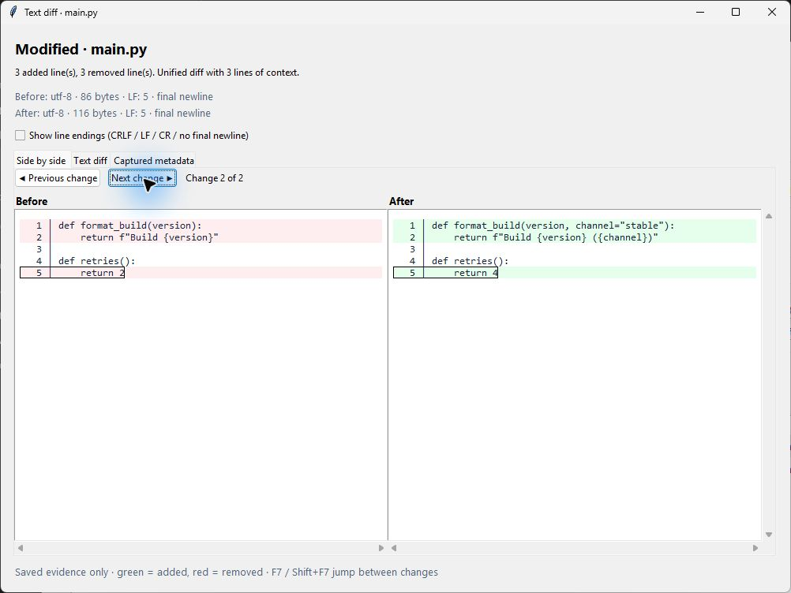

### Terminal theme and syntax highlighting

AppTrail starts with a Terminal-inspired dark palette. Use **Terminal dark theme** at the top right to switch between dark and light; your choice is saved locally in the history library’s preferences.json. Open diff and notes windows update immediately. Native Windows title bars and system file dialogs follow Windows appearance.

The side-by-side view colors keywords, comments, strings, numbers, functions, and types while retaining diff backgrounds, line numbers, line-ending markers, and navigation. Highlighting uses only saved text, handles multiline strings/comments, and never executes reviewed code. Supported formats include Python, JS/TS, JSON, YAML, TOML, INI, XML, HTML/CSS, C/C++, C#, Rust, Go, Java, shell/PowerShell, SQL, Markdown, Dockerfile, and Makefile. Other formats remain readable plain text.

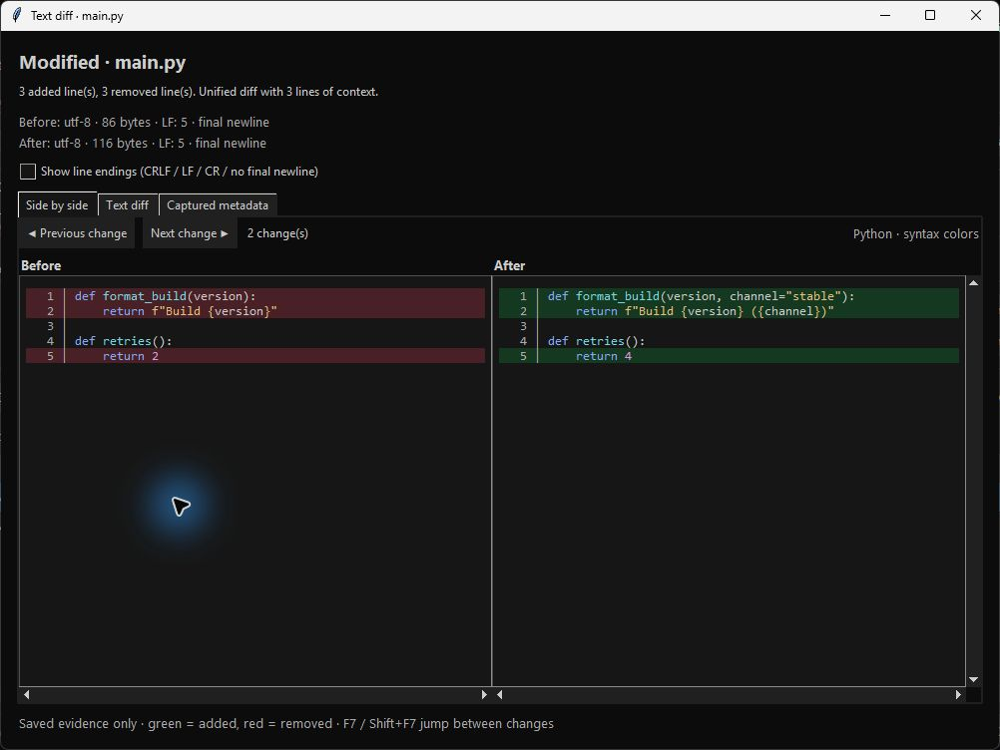

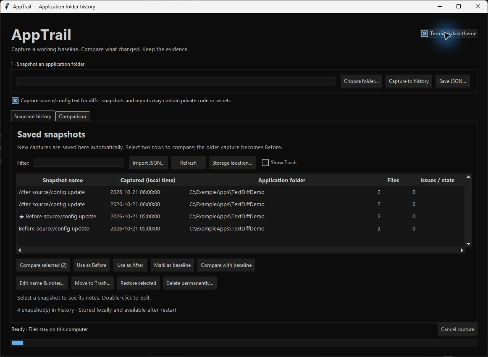

### See changes within a line

**Highlight changed words** is enabled by default in the side-by-side view. Paired modified rows show stronger red/green backgrounds on changed words, numbers, punctuation, and whitespace while preserving syntax colors. Inserted/deleted text is emphasized on the side where it exists; entirely added/removed rows keep their full-line backgrounds. Words (including Unicode identifiers) are compared as units. Paired rows follow the existing positional alignment within a replacement block.

Turn the toggle off for line-only shading. With **Show line endings** enabled, changed CRLF/LF/CR or missing-final-newline markers are emphasized too. Very long or repetitive comparisons use a bounded shared-prefix/suffix fallback that highlights the differing middle region. No live files are read and no snapshot schema changes are needed.

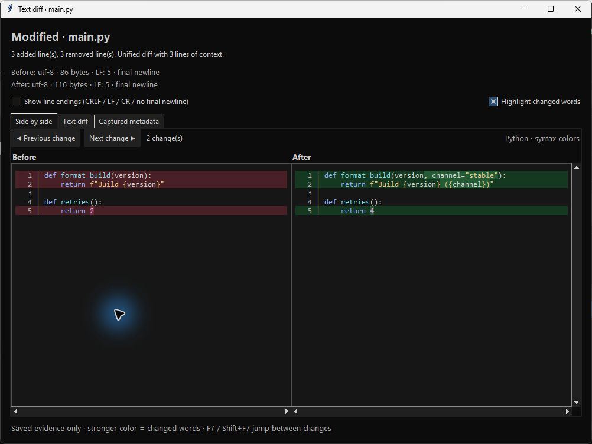

### Find text in both snapshots

Press **Ctrl+F** in the diff window or use **Find** above the side-by-side panes. Search is literal and case-insensitive by default; enable **Match case** for exact case. Matches in both saved snapshots are highlighted. **◀ Match / Match ▶**, **F3 / Shift+F3**, or **Enter / Shift+Enter** in the search box move between matches with wraparound. The counter identifies the Before/After side and original line number. Navigation scrolls to offscreen matches, including horizontally. **Clear**, or **Escape** in the search box, removes highlights.

Search reads saved file text only, excluding gutters, spacer rows, newline markers, and metadata. Identical occurrences in both snapshots count separately; navigation follows row order, Before then After. Matches are single-line and non-overlapping. Highlighting survives theme and diff-display changes. At most 10,000 matches are shown; the counter explicitly prompts you to refine a query if more exist. No snapshot format changes are required.

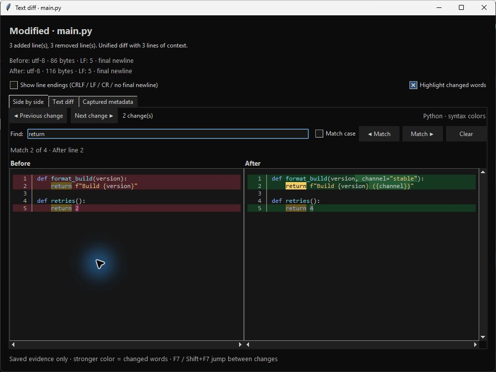

### Ignore whitespace-only changes

Enable **Ignore whitespace-only changes** in the side-by-side toolbar to suppress formatting-only highlights and skip those rows when navigating changes. The option restores your saved choice (off on first use). Spaces, tabs, Unicode whitespace, line endings, and inserted/removed blank-only rows are ignored when aligning existing files. Original text and line numbers remain visible and searchable; the status reports how many rows were ignored. Whole-file additions/removals remain changes. Toggle it off to restore exact comparison.

This filter removes whitespace for textual comparison, including whitespace inside strings or indentation-sensitive code; it does not prove semantic equivalence. Mixed lines with non-whitespace edits remain highlighted. Syntax colors, word highlighting, and search continue to work, and the active search occurrence is retained when alignment changes. The unified diff, HTML report, captured evidence, and file-level counts remain exact. No snapshot format changes are needed.

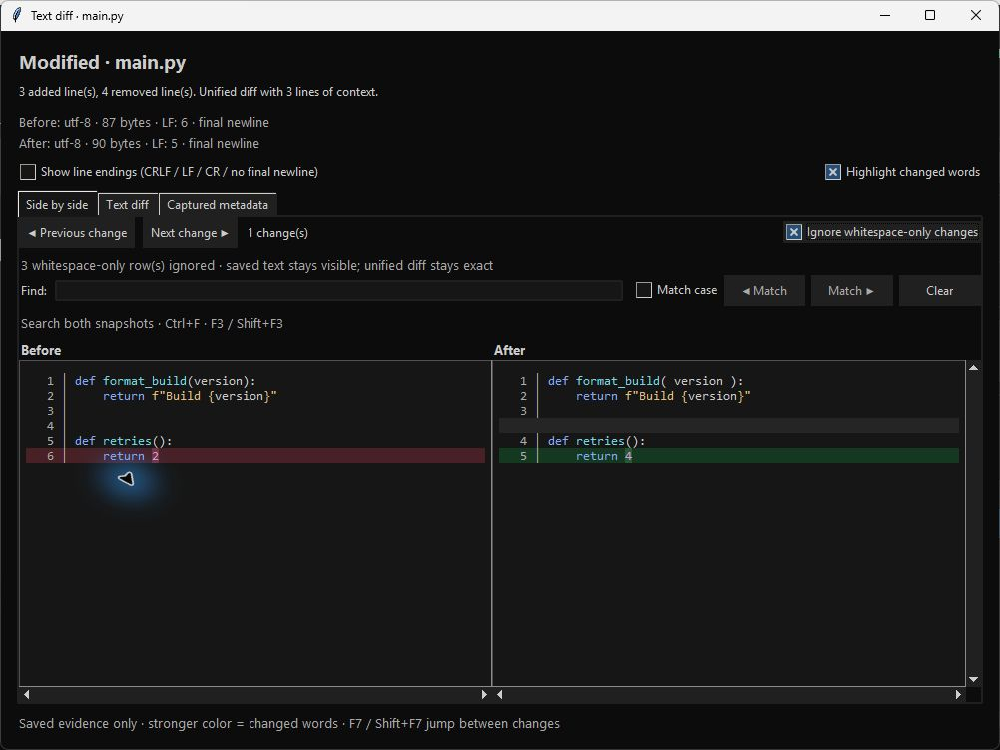

### Collapse unchanged code

Enable **Collapse unchanged lines** in the side-by-side view to focus on changes. Long unchanged sections become inline **unchanged rows · expand** buttons in both panes, retaining your selected number of context rows next to edits. Click either button to expand that section in both snapshots, use **Expand all** for the full file, or **Collapse again** to restore the compact view. Turning the checkbox off restores all lines. Sections with fewer than two hideable rows stay visible.

The option restores your saved choice (off on first use). Original line numbers, syntax/word colors, synchronized scrolling, and saved text are preserved. Search still scans the full saved text and automatically expands the section containing its active match; an active match remains visible when collapsing again. Individual expansions survive line-ending and word-highlight toggles. Changing the whitespace filter recomputes collapsed sections, treating ignored whitespace-only rows as unchanged. Unified diffs, reports, and snapshot evidence stay exact.

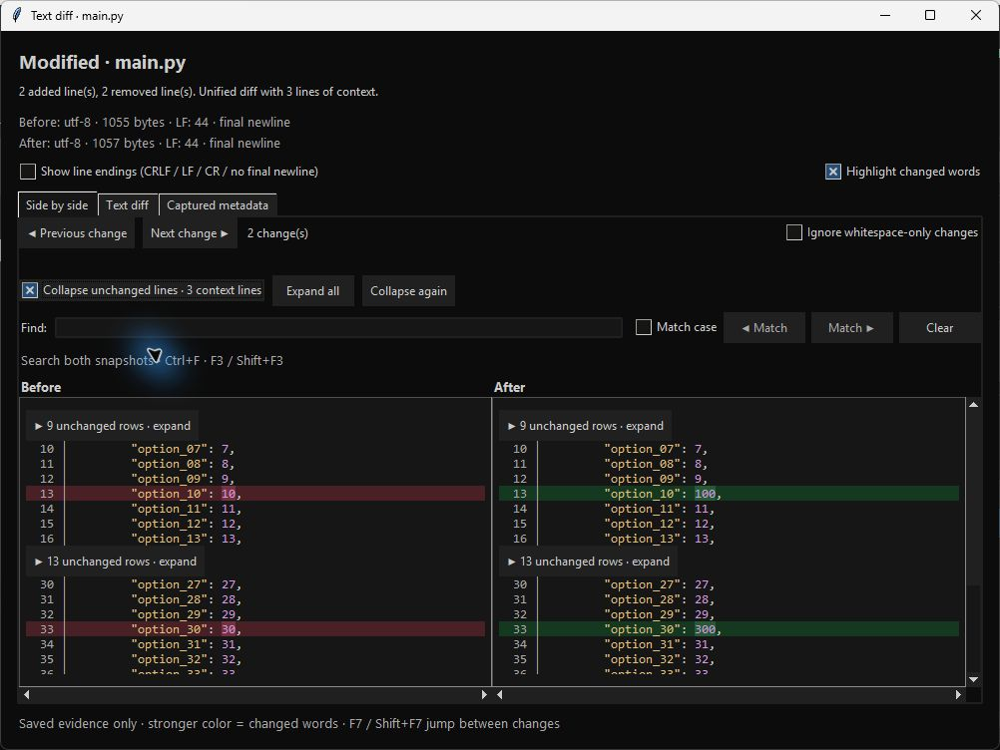

### Choose your context size

Set **Context lines** beside the collapse checkbox to a value from **0 to 100** (default **3**). Use the arrows, or type a number and press Enter or leave the field. Collapsed sections update immediately. The choice is saved in the existing history library’s preferences.json and is used by newly opened diff windows and future sessions. Theme changes preserve the context preference, and changing context preserves the theme. Existing open diff windows retain their own value. Invalid input restores the previous value; if saving fails, a warning explains that the value applies only to the current window. Search still reveals hidden matches.

### Remembered diff options

AppTrail remembers **Collapse unchanged lines**, **Ignore whitespace-only changes**, **Show line endings**, **Highlight changed words**, and search **Match case**, alongside your context-line count and theme. Checkbox changes save immediately in the history library’s preferences.json; newly opened diff windows and future sessions restore them. Existing open diff windows keep their current options. **Collapse again** also remembers that collapsing is enabled; expanding individual sections or **Expand all** is temporary and does not change the saved collapse choice. Search queries and individual expanded sections are not saved.

On first use, collapsing, whitespace filtering, line-ending markers, and Match case are off; word highlighting is on. Malformed saved values fall back to these defaults. If saving fails, AppTrail reports that the option applies only to the current window. No snapshot format changes are required.

### Export the current side-by-side view

Click **Export side-by-side HTML…** next to the collapse controls to save a standalone report for the current file. It preserves syntax colors, word-level change highlights, original line numbers, current dark/light theme, line-ending markers, whitespace filtering, context size, and which unchanged sections are currently collapsed or expanded. Your current literal search and active match are highlighted too. The export uses the current window’s options, including unsaved session-only choices.

Open the HTML in a browser. Native expandable sections reveal hidden code in both snapshots together. An embedded script provides review controls; no network access, external styles, or installed dependencies are needed. Horizontal scrolling keeps both columns aligned. The report includes the file’s saved contents, including initially collapsed code, and hashes/encoding summaries. Review it before sharing. The existing application-wide HTML report remains available from Comparison. [Example side-by-side report](examples/Side-by-side-report.html).

### Review an exported report in your browser

New side-by-side exports include **Previous change / Next change**, a **Find** box, optional **Match case**, match navigation, and a match/change counter. Navigation wraps at either end and automatically expands hidden context when needed. Use **Ctrl+F** for report search, **F3 / Shift+F3** for matches, **F7 / Shift+F7** for changes, or **Enter / Shift+Enter** in Find. **Clear** or **Escape** in Find removes search highlights. Search is literal, single-line, and non-overlapping; it scans both snapshots’ source text, excluding line numbers and line-ending markers. The 10,000-match limit is reported explicitly.

Reports retain their exported theme, syntax/word colors, whitespace filter, and context/expanded state. Browser search controls work offline through one fixed embedded script authorized by a CSP hash. Captured source remains escaped text; the report loads no external assets and makes no network requests. If scripts are disabled, use browser Find and native expand controls. Existing reports need to be exported again to gain the new controls. Browser review changes do not modify your AppTrail preferences.

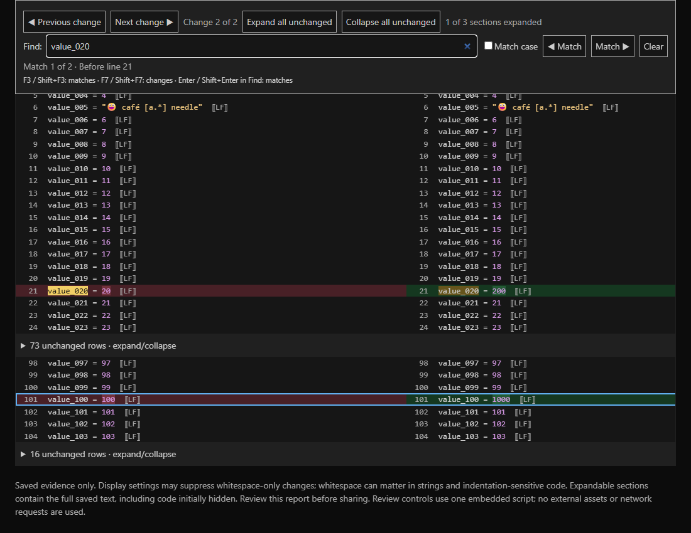

### Expand or collapse an entire exported report

Use **Expand all unchanged** to reveal every unchanged section in both snapshots, or **Collapse all unchanged** to return to a compact review. The section counter shows how many are open. These buttons leave source text, syntax/word colors, search highlights, and change navigation intact. Searching or navigating to a hidden match reopens its section. Controls are disabled when the export contains no collapsed-context sections; export from the app with Collapse unchanged lines enabled to create them. Individual section summaries still work, including without JavaScript. Re-export older reports to get the buttons.

To keep temporary CI storage small, automatic pushes test/build without uploading a duplicate workflow artifact. Manual workflow runs retain their downloadable build artifact for one day. Published release downloads are separate and retained.
